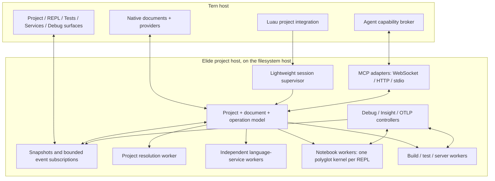

# Project sessions: Elide × Tern

Status: proposed architecture and implementation plan, audited 2026-11-05.

Implementation checkpoint, 2026-11-05: the initial shared Rust project/test host and
native view attachments are implemented (`elide` `ac613061b`, plugin `c4bc13a`).
Two real Tern views have been tested against the native runtime for shared results,
detach/reconnect, launch deduplication and cancellation. Carly's project/test exports
are the first agent bridge. Configuration remains explicitly `discovered`; canonical
workspace resolution, the event journal, WebSocket MCP, native document providers and
the subsequent inspection milestones below are not yet implemented by this slice.

Native workspace composition is now implemented: a project-bound action canvas,
Tern Files and native document editor, a terminal, and adjustable result splits.
The workspace reuses Tern's live document model; Elide document-provider/LSP hooks,
coverage decorations, and debugger integration remain pending. Launches use the
SDK layout API directly and are validated in an isolated desktop daemon/window.

This is the requested root-level working plan. It describes work in **Elide**, **elide-tern**, and **Tern / tern-sdk**.
It does not claim that proposed interfaces already exist. Registry, distribution CI, and product documentation are
separate workstreams; this plan supplies their eventual compatibility requirements.

## 1. The decision

Make a project session a first-class, headless Elide primitive. Tern attaches native editors, surfaces, and agents to
that session. A project has one coherent model of its configuration, documents, jobs, diagnostics, and observations,
with independently supervised services behind it.

**One project session does not mean one execution engine.** Each REPL is one persistent polyglot notebook kernel.
Language services, servers, test runs, debugger control, and agent connections have independent lifetimes and queues.
Blocking a guest evaluation must not block completion, cancellation, document edits, or debugger control.

Use Tern Surface Protocol deeply for presentation and interaction. Keep project state and operations in Elide so
Tern, Studio, ordinary CLI commands, and MCP clients can act on the same entities. Luau handles Tern integration;
it must not become a second project resolver, test engine, debugger, or language server.

### The experience we are building

Opening an Elide directory makes its project context available immediately. A quiet project indicator opens a native
overview with actual targets, running services, recent tests, problems, and agent attachments. Services initialize
on demand. Opening a directory alone does not execute project tasks or install dependencies.

The primary development loop is:

1. Open a source file with semantic completion and live problems.
2. Run a test or target from the editor, project view, command palette, or an attached agent.
3. Watch the same run in Tests; select a failure and reveal its exact source.
4. Edit, rerun the affected tests, and see current coverage in the editor.
5. Debug a selected test or server with breakpoints, stacks, scopes, and bounded object inspection.
6. Follow a request into its trace, logs, diagnostic, and optional Insight observations.
7. Ask an agent to investigate the selected failure or paused frame. It receives explicit project and source context
   and uses the same operations and revision checks as the UI.

Switching tabs changes visible context without silently retargeting a running agent or job. Closing an inspector
releases its view; project-owned jobs remain discoverable. Explicit Stop, Cancel, and Close project are distinct.

### Product priorities

| Priority | Outcome | Reason |
| --- | --- | --- |
| P0 | Shared session, identity, independent supervision, source revisions | Every later feature depends on correct ownership. |
| P0 | Real WebSocket MCP and Tern agent attachment | This is a central integration requirement, not a final add-on. |
| P1 | Native editing, semantic LSP, reliable Problems | Makes Tern useful for daily development. |
| P1 | Test → failure → edit → rerun → coverage | Completes the existing testing investment with immediate benefit. |
| P1 | Debug launch, breakpoints, stack/variables, debug test | Highest-value interactive inspection path. |
| P2 | Live Insight and richer correlated telemetry | Exploits runtime ownership beyond conventional IDE integration. |
| P2 | Proven late debug attachment, JVM debug adapter, richer source maps | Extend explicit capability coverage without overstating it. |
| P3 | Remote attachment, metrics/profiles, large-workspace optimization | Build on the same contracts; remote identity is designed from P0. |

Safety, correctness, responsive startup, and bounded resource use are release gates for every priority.

## 2. What exists, and what needs building

Audit baseline: installed Tern `0.9.12 (e498b49)`, Rust `tern-sdk =0.2.0`, plugin project-awareness commit
`aeb868e`. Tern conclusions come from installed generated definitions and published contracts, not a private Tern
source audit. Elide and Studio working trees can move independently; implementation must recheck their interfaces.

| Area | Implemented foundation | Missing for this design |
| --- | --- | --- |
| Project discovery | Nearest `elide.pkl`, pane context, project actions, project-specific history | Canonical resolved workspace/member model, durable leases, shared session |
| Embedded SDK | Studio-derived ABI/worker host, disposable processes, protocol exchange | Project binding, overlays, streamed service transport, independent cancellation |
| REPL | One polyglot kernel per notebook, JS/Python live bindings, CEL/Pkl adapters, native object browsing | Project dependencies/capability policy, session-owned notebook attachment |
| Native surfaces | Shared `crates/surfaces`, REPL, servers, traces, tests | Shared projections, cross-surface navigation, project ownership |
| Tests | TAP plus opt-in identity/timing metadata, IDE progress, native live results | Stable selectable test IDs, structured failure/fix data, selective rerun, coverage integration |
| Servers / OTLP | Supervised jobs; live capture controls; HTTP protobuf/JSON traces and logs | Project-owned receiver, full run correlation, metrics/profiles and gRPC intake |
| MCP | Transport-neutral dispatcher, stdio and HTTP SSE/POST, build/run/Insight contributors | WebSocket, Streamable HTTP adapter, live subscriptions, project-owned operations |
| Debugging | Truffle DAP/CDP setup; forked JVM tasks can launch JDWP | Interactive session controller, native views, source registry, JVM adapter |
| Insight | Function/statement watches, args/results/timing/call trees, JS/Python bridge | Scoped attach/detach on live workloads, bounded incremental collection |
| Coverage | JS LCOV, JVM JaCoCo, shared aggregate model | Accurate shared line/branch model, source identity, merging and editor overlays |
| Tern documents | Read/edit/save live buffers through native undo and dirty state | Exposed revisions/change stream, cross-client CAS, workspace edits and providers |
| Tern agents | Agent start/ask/transcript; Carly context and callable plugin exports | Project-scoped MCP registration, hot attachment, revocation and host adapters |
| LSP | SDK-owned Java and JS/TS compiler channels; partial embedded analysis | Tern provider API, full client lifecycle, project overlays and capability routing |

Concrete blockers to fix before claiming deep integration:

- `UnifiedDevServer.registerMcp` currently throws **“MCP does not support web sockets yet.”** Registering an endpoint
  is not a working WebSocket transport.
- `EmbeddingSession` serializes exchanges. Sharing that physical session between a busy REPL and LSP is unsuitable.
- Existing MCP contributors can cancel their work when the connection closes. Shared project jobs need a different
  owner and explicit lifetime policy.
- Current TSP edit validation checks previous UTF-16 length. Equal-length stale edits can still pass.
- Tern does not currently expose the complete document-provider or dynamic MCP attachment APIs proposed below.
- `DebugMcpContributor` runs one-shot Insight in a fresh runtime; it is not an interactive debugger.
- Insight watch attachment currently discards instrumentation binding handles. Periodic registry flush also repeats
  accumulated observations. Live detach and incremental observation need runtime changes.
- JVM coverage aggregate rows omit line hits; `TestCoverage.merge()` selects a better-covered row rather than
  performing a proper union. Neither is sufficient for reliable coverage gutters.
- Source maps are not end-to-end: stack trace mapping and Node-compatible source-map access have known gaps.

## 3. Ownership and process architecture



### Elide owns

- A lightweight host-local supervisor: registry, SDK compatibility, leases, admission limits, process groups,
  endpoint credentials, operation routing, bounded journals, and cleanup.
- A project service around the existing immutable `ElideProject` / `ElideWorkspace` model: canonical resolution,
  source sets, target graph, dependency/classpath snapshots, configuration generations, capabilities.
- Shared document/source, diagnostic, test, coverage, debug, and observation models.
- Execution and semantic services, with headless APIs usable from CLI, Studio, and Tern.
- Native surface controllers and reusable visual components, consuming those headless APIs.

Initially evolve the existing broker, then move reusable supervisor/client facilities into Elide-owned shared
crates consumed by Studio and this plugin. The `elide-tern` executable becomes a small adapter/bootstrapper.
Upstream the existing vendored Studio host changes instead of growing an independent ABI fork. Keep the existing
C ABI / Cap'n Proto boundary; add compatible capabilities and messages there when runtime changes are required.

### Tern owns

- Host identity, panes/layouts, native editor buffers/undo, input, theme, accessibility, and surface rendering.
- Native service/provider registration and project attachment to editors and agents.
- Agent-harness integration: supported protocol connections, tool visibility, event delivery, and lifecycle.
- The user-facing edit transaction and debugger-control ownership UI.

### Luau owns

Discovery hints, project selectors, palette/Files/status actions, pane creation, source navigation, and registration
of native service descriptors. All callbacks read cached state or initiate asynchronous work. Chrome callbacks
must remain within Tern's small budget; no SDK initialization or manifest evaluation in them.

### Worker rules

- The supervisor never loads GraalVM into Tern or into its own lightweight process.
- Project resolution and semantic workers stay independent of arbitrary guest execution.
- One REPL kernel blends supported languages; separate notebooks intentionally have separate state.
- A server or long test run uses a supervised job, not an evaluation with its deadline disabled.
- Debug control must remain serviceable while the target is paused or busy; do not route it through the target's
  serialized evaluation request queue.
- Use existing job/process-group/watchdog facilities. Killing a failed worker invalidates its handles and leaves
  unrelated services alive. Process supervision does not imply an OS sandbox.
- Use immutable run-context overlays per operation. Never switch a running daemon's global cwd/environment or
  JVM properties to accommodate another project/member.

Project-bound notebook creation carries a resolved project revision, member, dependency/classpath snapshot,
run-context reference and explicit execution capabilities into the SDK. Existing restricted kernels keep their
policy; project imports require a supported resolver/capability path, not blanket filesystem/environment access.
An existing kernel stays pinned to its configuration until an explicit reset/migration; changing language keeps
that kernel and its bindings. Give cells stable source URIs/revisions for diagnostics and debugging. Capability
discovery distinguishes shared live values, snapshot adapters, module-only execution and unavailable languages.

## 4. Identity, configuration, and lifetime

### Identity model

| Identity | Meaning |
| --- | --- |
| `hostId` | Authority for filesystem, processes, ports and credentials; local or remote |
| `checkoutId` | Canonical workspace/checkout instance on that host; worktrees remain distinct |
| `projectId` / `memberId` | Resolved project and selected workspace member |
| `sessionId` / `epoch` | Live compatible project service and its incarnation |
| `projectRevision` | Immutable successfully resolved configuration/dependency snapshot |
| `clientId` / `leaseId` | Particular window, view, agent or explicit background owner |
| `documentId` / `overlayId` / `version` | Document identity, editing branch and monotonic revision |
| `operationId` / `runId` / `workloadId` | Requested operation, execution attempt, and runtime instance |
| `kernelId` / `debugSessionId` / `observerId` | Scoped execution or inspection handles |

IDs are opaque strings. Paths locate a checkout; they are not authorization or complete identity. Replace the
discovery helper's `DefaultHasher` key with registry-issued identities. Credentials are never identity fields.

A reusable session is selected by host + canonical checkout/workspace + SDK/runtime identity + compatible
execution/trust profile. Configuration inputs produce a versioned snapshot inside it; incompatible startup options
require new workers or an explicit new session. A member selection or nested invocation cwd is not a new workspace.
Each client/operation pins its immutable snapshot and evaluation profile. Conflicting manifest-evaluation flags
create distinct snapshot variants or incompatible sessions; one window cannot reconfigure another window's work.

Nearest-manifest discovery remains cheap and non-evaluating. Activation asks Elide's existing resolver to determine
explicit selection, enclosing inheritance, declared workspace membership, and source sets. Do not infer these in
Luau. Configuration failure leaves a usable project shell with diagnostics; retain the last valid snapshot when
available, visibly mark it stale, and never silently run a newly requested target under invalid new configuration.

### Lifecycle

`discovered → resolving → ready | degraded → quiescent → closed`

Each service separately reports `unavailable | starting | ready | busy | failed`, with structured reasons and
actual capabilities. A failed Python worker must not make Java completion disappear.

Attachments acquire renewable leases. Proposed initial defaults: heartbeat every 10 seconds, 60-second reconnect
grace, and 120-second idle reclamation after the final eligible owner disappears. Make these configurable and test
with a fake clock. Finite project-owned jobs hold leases until terminal state or their configured deadline, then
release them. Long-lived servers follow an external project owner through reconnect grace; keeping one beyond the
last external owner requires an explicit background pin. No job can renew itself forever accidentally.

Ownership rules:

- Views own presentation state. Closing a project inspector detaches it.
- REPL tabs own notebook leases; restoring a view can reattach within the lease lifetime. A lost kernel is reported
  as lost, never reconstructed by replaying cells.
- Starting a project server/test creates an operation lease. Multiple views/agents can observe it.
- Temporary legacy standalone surfaces retain their current close-to-stop behavior until migrated. The new
  project UI must show which jobs will survive view closure.
- Focus changes never release another pane's project or retarget its agent.
- Client disconnection cancels only explicitly request-scoped operations. Project jobs survive reconnect grace.
- Close project releases owned services and stops its jobs according to explicit ownership; it does not stop a
  different project's worker. Force stop remains available for unresponsive children.
- A supervisor crash may lose execution state. Recovery changes `epoch`, reconciles persisted terminal results,
  marks interrupted work, and relies on watchdogs to reap children. No invisible rerun of tests, servers or edits.

Persist small registry metadata, preferences, terminal run summaries and bounded report references. Do not persist
credentials, environment values, guest handles, paused frames, or unsaved text by default. Runtime IDs cannot be
revived from disk. Follow existing report/history facilities and place large artifacts under `.dev/`.

## 5. One domain API, several protocol adapters

The following are proposed internal contracts, not new standard MCP method names:

```typescript
type SourceRef = {
  documentId: string; overlayId?: string; uri: string;
  version?: string; projectRevision: string;
  content: { kind: "known"; digest: string } | { kind: "unavailable"; reason: string };
  generatedFrom?: string; sourceMapId?: string;
};

type Command = {
  schemaVersion: number; sessionId: string; epoch: string; clientId: string;
  commandId: string; idempotencyKey?: string; expectedRevision?: string;
  kind: string; payload: unknown;
};

type Event = {
  schemaVersion: number; sessionId: string; epoch: string;
  stream: string; sequence: string; entityId: string; entityRevision: string;
  operationId?: string; runId?: string; source?: SourceRef;
  traceId?: string; spanId?: string; kind: string; payload: unknown;
};
```

These sketches define semantics; use typed variants and generated schemas in implementation, not arbitrary
unvalidated command strings. Bind `clientId` to authenticated transport identity instead of trusting its payload.
Use string counters at JSON/Luau boundaries to avoid precision loss. IDs, source references, and correlation survive
projection into different protocols; TSP node IDs never become domain IDs.

Service operations cover project/capabilities, documents, targets/jobs, notebooks, tests, diagnostics, coverage,
debugging, observations, and code-index queries. Queries are budgeted and pageable. Commands return an immediate
acknowledgement or operation handle; accepted, running, cancel-requested, cancelled, failed, and completed differ.
One action registry supplies eligibility, required capabilities, typed arguments and resulting entity links to
palette commands, surface buttons and agent adapters. Availability is rechecked on execution, not only when a
button renders. This prevents different launch/edit/debug behavior depending on which entry point the user chose.

Schedule mutations by declared resources: install/lockfile changes, build-output writers and clean operations
serialize when they overlap, or use isolated output roots. Multiple agents cannot race a clean against an active
build. Reads and independent jobs remain parallel. Prefer existing task-graph/cache locks and deterministic lock
ordering; expose queued/resource-waiting state and make queued cancellation cheap.

### Ordering, recovery, and load

- Subscribe by snapshot plus cursor, atomically establishing the boundary so updates cannot disappear between
  snapshot and subscription. Use per-stream order; no fictitious total order across hosts or independent streams.
- Record entity revisions and causation IDs. Duplicate delivery is harmless; a replay gap requires resnapshot.
- A bounded reliable control queue carries edit acknowledgements, job transitions, debugger stops and diagnostic
  replacement. When capacity is exceeded, stop admission or disconnect/resynchronize the slow client explicitly.
- Telemetry/output queues can sample, truncate or evict with visible counters. They never starve cancellation,
  document changes, or debugger control. Large artifacts travel by bounded resource reads, not giant events.
- Separate reader, dispatcher and writer tasks. The current serial `McpSession.receive()` cannot be awaited in a
  socket frame loop that must also receive cancellation. Replace unlimited outgoing channels with bounded ones.
- Persist/deduplicate accepted mutation keys within a documented retention window. After reconnect, query the
  operation before retrying; expired keys return uncertainty, not a silent duplicate launch. Evaluation, resume,
  edits and other non-idempotent commands are never blindly replayed.
- Maintain separate budgets for control, language services, source transfer and observations. Define limits in the
  versioned service descriptor and exercise overload behavior before release.

TSP stdout, LSP framing, MCP framing, TAP reports and application output remain separate streams. No protocol
scrapes another protocol's human-readable presentation.

## 6. WebSocket MCP and agents

### Transport and version policy

Implement a genuine full-duplex **WebSocket MCP binding** over the shared project services, and give it first-class
support in Tern's native host. Keep standard transports for portable clients.

The current MCP standard defines stdio and Streamable HTTP; WebSocket is a custom binding. The `2026-07-28`
revision uses per-request protocol/capability metadata and no server-initiated JSON-RPC requests. Older
initialize/session semantics require compatibility handling. These are different protocol eras, not merely
different URLs. [MCP transport specification](https://modelcontextprotocol.io/specification/2026-07-28/basic/transports)

Elide's current `McpSession` accepts `2024-11-05`, `2025-03-26`, `2025-06-18`, and `2025-11-25`. Preserve tested legacy
behavior while adding a separately tested modern adapter; do not advertise `2026-07-28` before implementing it.
The first paired Tern/Elide WebSocket milestone can use the existing negotiated legacy revision, with explicit
profile/version fields. Complete modern compatibility before declaring the new public transport stable.

Proposed binding profile `elide.mcp.v1`:

- Authenticated upgrade; one complete UTF-8 JSON-RPC object per text message. Fragmented WebSocket messages are
  assembled within a limit. Reject binary messages and unsupported batches; no custom wrapper around MCP JSON.
- Descriptor declares binding version, supported MCP revisions, message/queue limits and endpoint lifecycle.
- Upgrade selects the binding; MCP revision follows that revision's rules. Neither socket nor project session
  substitutes for protocol negotiation. Project/session identity is application state independent of MCP sessions.
- Ping/pong, idle timeout, bounded frames, independent cancellation/control processing, explicit close reasons.
- Each agent has separate request IDs, protocol state, identity, capabilities and connection lease.
- Resume application resources/operations through cursors and handles; do not pretend WebSocket reconnect itself
  resumes MCP requests. No unauthenticated resume tokens.

Use private local IPC for rendezvous/supervisor control. Reuse existing framing at the embedded SDK boundary.
Add Streamable HTTP and a stdio bridge over the same handlers; keep existing SSE compatibility isolated. Native
project events and editor synchronization have their own typed subscription channel; do not invent reserved MCP
notification methods for them. MCP subscriptions use the negotiated protocol's mechanisms.

The modern Tasks extension supports deferred results and status via `tasks/get` or `notifications/tasks` on
`subscriptions/listen`; it forbids generic progress/log notifications for tasks. A completed test run with failing
tests is a completed tool result with domain failure information, not a task-level JSON-RPC failure. Adopt this
extension only when negotiated. Legacy clients receive bounded operation handles and status/cancel tools. Project
jobs remain the underlying authority in either case.
[MCP Tasks extension](https://tasks.extensions.modelcontextprotocol.io/specification/2026-07-28/tasks)

### MCP surface area

Use a small discoverable tool set grouped by purpose. The names below are proposed tool/resource families, not
reserved protocol methods. Every mutation requires the target session and relevant expected revision/ownership.

| Family | Operations/resources |
| --- | --- |
| Project | Snapshot, members, actual capabilities, targets, SDK status and configuration problems |
| Code | Versioned source reads, symbols/references/provenance from the addressable index, source reveal |
| Documents | Prepare/preview/apply edit transaction; query outcome and conflicts |
| Jobs | Run target, status, cancel, bounded output, artifact references |
| Tests | Discover, run selection, failures, debug selected test, result/coverage resources |
| Runtime | Open/attach notebook, explicit evaluation, service lifecycle |
| Debug | Inspect stop, stack, scopes and variables; separately authorized breakpoint/control/evaluate |
| Observe | Trace/log queries, diagnostic sets, attach/update/remove Insight observer |

Resource URIs contain opaque scope IDs and immutable source/run references; paths never grant access. Results
contain structured data, compact summaries, source links and page cursors. Native views and agent outputs can link
to the same object. Runtime objects use scoped handles and passive previews rather than eagerly serializing heaps.

### Tern's agent capability broker

Propose a native host API to register, update, attach and revoke a project service descriptor:

```typescript
type ProjectServiceDescriptor = {
  hostId: string; projectId: string; sessionId: string; epoch: string;
  label: string; health: string;
  transports: Array<{ kind: string; endpoint: string; binding?: string; revisions: string[] }>;
  credentialHandle: string; // opaque host-managed reference, never the credential itself
  capabilities: string[];
};
```

Tern routes the descriptor to each supported agent harness, observes its connection health, and exposes attached
tools/resources without rewriting global agent configuration. An agent launched in project A stays bound to A;
child agents inherit a scoped binding. Explicit retargeting revokes the old lease before adopting another project.

Three integration levels must remain visible:

1. **Available now:** Carly's cached context and asynchronous callable exports. Keep summaries compact and calls
   bounded; use operation handles for work exceeding its limits. Installed contracts allow 16 exports, 120-second
   asynchronous calls, and 1 MiB answers. This is the initial bridge, not a claim of universal MCP hot-plug.
   [Tern window API](https://docs.stencil.so/tern/reference/api-window.html)
2. **Native Tern integration:** managed agents get live service attachment, resource subscriptions, capability
   changes and revocation. New agents receive the binding during launch; supported running agents attach live.
3. **External terminal agents:** use a supported host adapter or stdio launcher bridge. If a harness cannot change
   tools while running, report that limitation; do not simulate attachment with an environment variable.

Carly exports are an operation bridge, not a WebSocket client. Current Luau has no WebSocket API; the native Tern
host or an explicit native client bridge owns that connection. Acceptance must exercise actual WebSocket delivery,
not pass solely through subprocess polling. A supported already-running agent must attach, receive updates and
lose permission to start new operations when its project grant is revoked.

Track harness capabilities separately: transport connection, tool refresh, resource updates, context delivery,
and autonomous turn initiation. A WebSocket notification can update cached context or a UI without causing a model
turn. Sending selected failure/frame context into a conversation is a host-level action. Background agent work
must be explicit and bounded; repository text and tool output do not become privileged instructions.

Provide an agent attachment view with project, active operations, connection state and granted controls. Selection
sharing is opt-in per interaction: “Investigate this failure” passes immutable IDs and source revisions, not an
unstable notion of whatever happens to be selected later.

### Authority and credentials

Separate observe, read source, edit, run code, debug-control, debug-evaluate and instrumentation capabilities. A
read-only agent cannot acquire execution permission through an alternate MCP or TSP adapter. Tern translates
existing user/project authorization into scoped grants; avoid repeated approval for already-authorized operations.

Use private owned rendezvous storage and host-mediated credential handles. Never put bearer tokens in URLs, shell
arguments, project files, logs, telemetry or tool results. Loopback listening is not authentication: validate
Host/Origin on HTTP/WebSocket entry points, reject unintended browser origins and confine path resolution using
canonical project policy. Same-user malicious processes are outside the current broker's isolation guarantee;
do not describe these credentials as an OS sandbox.

Remote service descriptors identify the remote filesystem/process host. Forward authenticated channels through
Tern's host connection; never execute a remote pane's project locally or expose debug/OTLP ports publicly by default.

## 7. Documents, LSP, editing, and source identity

Tern's native document machinery owns visible buffer edits, dirty state and undo. Elide coordinates versioned
overlays and consumes them for analysis, commands and runtime/source mapping. Do not introduce an independent
editable buffer inside every inspector.

### Required Tern contracts — new APIs

1. Document open/change/save/close events with URI, language, revision, origin and overlay identity; atomic snapshot
   subscription so the first read cannot miss changes.
2. Snapshot reads and compare-and-swap edits by expected revision/hash. Multi-file workspace edits validate all
   preconditions before changing buffers and apply as a coordinated undoable transaction. Saving to disk is a
   separate explicit operation; report partial I/O failures honestly rather than claiming filesystem atomicity.
3. Owner-scoped providers for diagnostics, coverage, breakpoint/stop markers, inlays and semantic features. Provider
   teardown removes its decorations; priority rules prevent coverage from hiding a breakpoint or current stop.
4. Source reveal by URI/range/content identity with explicit focus policy, including historical read-only snapshots.
5. LSP provider registration by project/language/capability and managed bidirectional transport.

Existing `cx.docs` operations already edit live buffers and reject a buffer changed during their preparation.
They do not expose a revision that spans a service's earlier read → compute → apply transaction. Until the new
contract exists, source preview/navigation are safe milestones; full concurrent agent editing is not complete.
[Tern window API](https://docs.stencil.so/tern/reference/api-window.html)

A single editing branch has one logical authority; split views can share it. If another window/editor presents a
divergent unsaved buffer, assign a separate `overlayId` and show the conflict. Do not merge branches by URI alone.
Closed-file edits must check the disk digest and adopt any newly opened buffer before application. Detect external
modification, rename and deletion; preserve provenance and make reconciliation explicit.

### Semantic services

- Reuse SDK `CompilerChannels` for Java and JS/TS where present. Route service capability discovery from the actual
  bundle. Partial embedded lexical analysis must be labeled as such.
- Add Python/Kotlin/Pkl/CEL services through explicit provider adapters and availability, not invented parity.
- Keep LSP workers independent of guest kernels. Handle initialize, document versions, cancellation, progress,
  server requests, workspace configuration and edits through a complete LSP client.
- Do not blindly multiplex multiple raw LSP clients into one channel. A document coordinator owns a worker's
  lifecycle, or clients receive isolated channels backed by shared immutable project snapshots.
- Route semantic channels by overlay identity or elect one explicit shared overlay. Divergent unsaved buffers at
  the same URI must not send changes into the same raw LSP document lifecycle.
- Opening a project never implicitly downloads language servers or dependencies. Missing SDK services are normal
  capability states with a direct setup action.

Every source-bearing diagnostic, test location, coverage record, breakpoint, frame and observation references a
`SourceRef`. Source-less configuration/task failures and native frames remain valid; unavailable source bytes are
explicit. Never fabricate a URI, digest or range, or treat unknown content as current.
Normalize LSP/TSP UTF-16 offsets and debugger line/column conventions at adapters. Test surrogate pairs, combining
characters, CRLF, multiline edits and generated sources. Never assume a protocol's position encoding without
negotiation or adapter conversion.

Maintain a source-map registry keyed by generated and original content digests. Breakpoint binding and navigation
can fail or be approximate; surface that state. Historical runtime frames open the loaded source revision when
the editor has moved on. A stale coverage layer never decorates current text as if freshly measured.

Consume the addressable code index for dependency navigation and provenance. Missing index layers remain explicit
and can be requested as build tasks. No runtime directory/archive scans. Observed code/type facets stay separate
from static cached metadata and retain lockfile/content fingerprints.

## 8. Native surfaces and visual system

Build a small shared view/component layer above `crates/surfaces` and canonical `tern-sdk`. The project service
produces domain state; view controllers select, paginate and project it into native nodes. Tern remains the layout,
theme, font, input and accessibility authority.

### Surface family

| View | Primary content | Cross-workflow actions |
| --- | --- | --- |
| Project | Actual members, targets, services, recent runs and problems | Open source, run/test/debug target, attach agent |
| REPL | Language-aware notebook transcript and expandable values | Reveal source/value, inspect kernel, start new notebook |
| Tests | Run summary, test tree, failure detail, output | Reveal, rerun failed/selected, debug, show coverage |
| Services | Lifecycle/readiness, URL, requests and bounded logs | Open trace, debug launch/attach if supported, Insight |
| Problems | Grouped structured diagnostics and fixes | Reveal exact source, apply fix, view related run/trace |
| Debug | Target/thread/stack selection, scopes, variables, watches | Breakpoint control, step/resume, source reveal |
| Coverage | Source-set/file overview, line/branch detail | Reveal uncovered source, run responsible tests when known |
| Observe | Trace waterfall, logs, Insight observations; later metrics | Follow causal links into source, test, request or debug target |

Use “REPL”, “Tests”, “Debug”, and “Problems” in the UI. Project identity appears once in context. Language labels
appear when the language changes, not on every result. Empty statement results remain silent.

Add a proposed native resource-presentation registry so Tern can open the appropriate projection for a typed
project/run/test/trace/source reference. Agent tool cards can embed or reveal the same bounded test detail, trace
or edit preview as the project UI, with the same action IDs and authority checks. MCP returns structured resource
references; the registered trusted renderer supplies UI. Do not execute arbitrary UI code from a tool result.
Keep renderer registration generic in Tern and Elide's domain-to-view mapping in the integration.

Visual rules:

- One compact context/command row, a clear main list/tree, and progressive detail. Avoid a wall of outlined cards,
  duplicate status labels, raw protocol JSON, or every capability appearing as a top-level tab.
- Responsive master/detail layouts: narrow panes drill into details; wide panes keep selection and detail together.
- Use supported SDK/Tern named language/status icons with text fallback. Color supports meaning;
  it is not the sole indication of failure, coverage or debugger state.
- Stable keys preserve focus, tree expansion, selection and scroll. Keep those per-view; shared job state remains
  service-owned. Use native timing/animation primitives rather than repaint timers for clocks.
- Structured bounded object trees, source previews, trace waterfalls and native editor decorations replace ANSI
  terminal emulation. A copy/export action exposes full retained artifacts separately.
- Keyboard navigation, visible focus, screen-reader labels, dark/light themes and reduced-motion behavior are
  acceptance requirements. Do not show unsupported controls as if they worked.

TSP already has editor decoration/gutter/virtual-line primitives. Canvas excludes interactive editor/input nodes;
source interaction belongs in native file panes or supported surface blocks.
[Tern editor primitives](https://docs.stencil.so/tern/elements/input.html)

Use keyed incremental updates and SDK credit/coalescing behavior. A TSP frame's visual atomicity is not database
transactionality: individual invalid operations may be rejected. Recover a failed projection from a fresh model
snapshot. Negotiate optional node capabilities and preserve an accessible fallback.
[TSP frames](https://docs.stencil.so/tern/protocol/documents.html),
[TSP handshake](https://docs.stencil.so/tern/protocol/handshake.html)

Proposed TSP additions should be generic: source-reference navigation, revisioned editing, provider-owned
decorations and service attachment. Keep Elide-specific target/test semantics in Elide. Do not fork the protocol or
encode debugger meaning in CSS selectors. Advanced guest-created surfaces remain a later feature; this work covers
Elide-owned interfaces first.

## 9. Tests and coverage

Preserve existing TAP and IDE events as compatibility/reporting adapters. Introduce a canonical versioned test
event model sourced directly from JS/JUnit engine records, then project to TAP metadata, IDE events, TSP and MCP.
Do not reverse-parse human output when typed data is available.

Required events: discovery, run/suite/test start, output, diagnostic, result, coverage artifact, run completion and
cancellation. Include stable engine/test selector, run/attempt IDs, source-set/container identity and source refs.
Display names and settle-order TAP numbers are not durable test identity. Preserve original failure diagnostics.
Adapters without selective execution advertise that limitation and offer the next valid suite/file scope.
Output explicitly belongs to a run, a known test, or an unattributed stream. Concurrent ambiguous output must not
be assigned to the nearest test or whichever label most recently appeared.

Keep existing opt-in TAP extensions backwards compatible. Add fields only with a versioned contract and fixtures
for concurrent duplicate names, out-of-order completion, skip/todo, cancellation and truncated reports. Missing
terminal records produce an incomplete run, not a false pass. Raw artifacts remain available.

Coverage needs a polyglot-free immutable model: measurement kind, engine, run/attempt, source digest, scope,
line/branch counters, exclusions and completeness. Project the existing in-memory JaCoCo analysis into genuine
line/branch data; XML is an import adapter/fallback, since report generation is optional. Preserve JS LCOV semantics.
Merge disjoint shards by identity and compatible measurement rules, deduplicating replayed chunks.
Do not combine different source revisions or sum unrelated reruns. Mark unsupported detail as unknown.

Testing UI commands: run all, selected, failed, file/source set; cancel; debug selected; compare attempts; show
coverage. Save-and-run and run-from-overlay are distinct policies. Default disk-based engines disclose unsaved
changes; execute an overlay only where a real adapter supports it. Attribute every result to executed content.

Coverage collection capability is separate from report viewing. Do not promise retroactive coverage of code that
ran before instrumentation. Initially annotate compatible current source and provide historical snapshot detail.
Test-to-line attribution and impacted-test selection require real attribution data; absence must not produce a
guessed “affected tests” claim.

## 10. Interactive debugging

Use a session-owned debugger model with DAP as the primary adapter. Reuse Graal DAP/CDP configuration rather than
reimplementing the language debugger in Luau. Preserve CDP for compatible tools. Existing JVM run/test JDWP launch
is useful, but needs a JVM adapter/controller for the unified UI.

`DebugSession` records workload, generation, adapter/language capabilities, state, breakpoints, controller lease
and stop epoch. States include starting, running, stopped, disconnecting, exited and failed. Stopped state carries
thread/stack/source identity. Frame and variable handles expire on resume/restart; stale reads fail explicitly.

Native controls cover launch, pause where supported, continue, step over/in/out, stop, exception breakpoints,
conditional/log breakpoints where supported, thread/frame selection, scopes, variables and explicit evaluation.
Distinguish requested from verified breakpoints and preserve reason/location for an unbound breakpoint.

Many clients may observe; one controller owns step/resume operations. Human takeover is visible and revokes the
prior controller lease. Commands include stop epoch so an agent cannot resume a later, unrelated pause using a
stale decision. Explicit evaluation is mutation-capable; normal variable expansion uses bounded passive previews
and does not invoke getters or language display callbacks automatically. Verify this inside each adapter/runtime:
a DAP variable request may already trigger formatting before returning JSON. Targets without passive inspection
support show opaque handles or require explicit evaluation; sanitizing the returned JSON is insufficient.

When the controller disconnects at a pause, retain stopped state through reconnect grace and expose takeover to
authorized humans/controllers. A launch-owned target defaults to stop after grace if nobody takes control; choose
and show this policy at debug launch. External attachment requires an explicit backend-supported detach policy,
including whether detach resumes execution. Never silently resume or leave an indefinitely ownerless pause.

First ship **debug launch** for supported JS/Python workloads and selected tests. Current debugger options are set
at engine construction. Late attachment to ordinary running workloads requires an additional tested runtime
adapter; label launch-only, attach-ready and attached states separately. Avoid opening public debugger ports.

Later add JVM control around existing JDWP and validate cross-language stack behavior for actual runtime
combinations. A shared polyglot context does not imply identical debugger/step semantics in every language or a
single stack across separate JVM processes. Capability discovery, not branding, decides what the UI offers.

## 11. Insight, diagnostics, and telemetry

### Live Insight

Expose attach/update/pause/remove observer operations on a specific live workload/context. An `ObserverLease`
contains filters, capture types, budgets, sample rate, owner, generation, cursor and dropped-count metadata.

Runtime prerequisites:

- Retain every `EventBinding` from watch attachment and dispose it deterministically on lease removal/target exit.
- Replace engine-global accumulation with scoped, thread-safe bounded observation buffers and snapshot/delta drain.
- Filter before expensive capture; avoid unbounded per-event allocations, FFM roundtrips or guest serialization.
- Use passive REPL-style value previews and paged object handles. Current `WatchValueSerialization.getMember`
  and uncapped full-array mode are not appropriate defaults for automatic observation.
- Default to bounded immutable capture-time snapshots. Optional live handles belong to the observed context,
  require its permitted runtime execution thread, and are revoked on termination. Transport/render threads never
  dereference guest values. Label later live reads separately from values captured at event time.
- Instrumentation callback errors become observation errors, never exceptions in the observed application.
- Propagate run/context/trace correlation where real context exists; do not invent causal links from timestamps.

Start with function call count, duration, exceptions and bounded arguments/results for supported JS/Python targets.
Add statement/local sampling and call trees after overhead and detach tests. “Watch this function” from source or a
trace creates a declarative scoped observer; arbitrary Insight scripts remain explicit code execution with the
appropriate capability. Instrumentation pause/removal must not restart or reset the application.

### Reliable diagnostics, correlated through OTLP

`DiagnosticSet` is authoritative state keyed by producer, project revision, source/overlay version and generation.
It preserves severity, code, ranges, related information, fixes, stable diagnostic IDs and operation/test/trace links.
Producer replacement/clear is explicit; a producer crash becomes stale/unavailable state instead of leaving eternal
apparently-current errors.

Preserve typed diagnostics from existing receivers before formatting them into text. Project the same sets into
Problems, editor/LSP, MCP resources and structured OTLP logs/events. Use standard semantic conventions where they
fit; version additional `elide.*` attributes. Deduplicate by diagnostic ID/generation and retain origin to avoid
OTLP → diagnostics → OTLP feedback loops.

**OTLP is a correlation/export path, not the only delivery path for diagnostics.** Sampling, capture pause, bounded
retention or exporter failure must not drop an edit acknowledgement, debugger stop, test completion or resolved
diagnostic clear. Imported runtime exceptions can create a diagnostic with explicit provenance and expiration.

### Session-owned telemetry

Move the local capture receiver/store from a particular server surface to the project observation service.
Individual workloads lease a destination; closing a trace view does not disable capture for another view/agent.
Keep existing remote exports independent. Pause/resume/clear and per-workload filters remain live operations.

Correlate builds, tests, requests, notebook operations, agent tools and Insight observations through real trace
context and domain IDs. Preserve trace sampling/drop/incomplete status, and redact secrets before storage or export.
Avoid recording source text, environment values and arbitrary tool arguments by default. Exclude the collector's
own traffic from recursively tracing itself.

Current receiver limits are 512 records, 4 MiB and five minutes, with a 2 MiB request limit. Preserve bounded behavior
while evolving per-session quotas. Existing intake supports OTLP/HTTP protobuf/JSON traces and logs, including gzip.
Metrics/profiles and OTLP/gRPC require explicit collector and UI work. Add them after the source/run correlation
model; the first extension should be useful server/resource metrics with honest temporality and reset semantics.

## 12. Joint implementation sequence

Each milestone must be usable in real Tern and committed separately. The table names ownership and exit criteria,
not estimated dates. Streams B and C can proceed together after the contracts in A are fixed.

| Milestone | Elide / shared host | elide-tern | Tern / SDK | Exit criterion |
| --- | --- | --- | --- | --- |
| A — session spine | Identity, canonical snapshot, leases, capability model, operation registry, bounded events | Attach existing actions and show native project overview | Review service descriptor and host identity contract | Two views share one project/run; another checkout stays isolated |
| B — live agents | WS legacy profile, async dispatch/cancel, resource snapshots, job ownership; modern/HTTP adapters | Carly bridge and stdio bootstrap, session attachment UI | Native service registry and managed-agent attach/revoke | Running agent attaches over WS, receives live updates, reconnects without duplicate work, and loses mutation access on revocation |
| C — document authority | Source registry, overlays, diagnostic sets, independent compiler services | Navigation and Problems; semantic provider wiring | Version/change APIs, provider registration, transactional edits | Unsaved Unicode edit reaches LSP; stale agent edit is rejected |
| D — complete testing | Canonical test events/selectors, selective execution, real coverage IR/merge | Refined test/detail/source/coverage views | Coverage decorations and source reveal | Failure → edit → selected rerun → valid coverage, including JVM fixture |
| E — interactive debug | DAP controller, debug launch, stop epochs, scoped variable handles | Native Debug view and debug-test/server actions | Breakpoint/stop decorations and controller affordances | Human/agent inspection of one pause; stale resume cannot affect next pause |
| F — live runtime insight | Scoped bindings, bounded deltas, live observer control; diagnostic OTLP projection | Source/trace → observer workflow, linked observation views | Generic navigation/selection integration as needed | Add/remove observer on live server without changing app state |
| G — broaden and qualify | JVM adapter, validated late attach, source maps, metrics/profiles, remote host support | Remote routing, graceful capability states, responsive polish | Remote capability routing and provider hardening | Cross-host identity, failure, load and visual acceptance suite passes |

Modern MCP compatibility, authentication, cancellation and bounded queues are part of B's public stability gate,
not work deferred to G. Foundational diagnostic correlation ships with C; F enriches runtime/OTLP integration.
Basic coverage can proceed alongside E once C's document contracts are available.

### First paired implementation batch

1. **Elide: project session contracts and resolver adapter.** Define typed snapshots/commands/events, identity,
   compatibility and lease tests. Use the existing project model and run context. Add a headless service entry point
   suitable for both embedded SDK hosting and CLI launch; exact command spelling is an implementation detail.
2. **Elide: supervisor and job attachment.** Extract reusable hosting facilities, keep semantic workers isolated,
   move test/server operation ownership behind the service, and add snapshot/subscription recovery.
3. **Plugin: native project session client.** Replace hash-only runtime grouping with real attachment, migrate
   existing Tests/Services/REPL launch actions, preserve established notebook behavior and visual quality.
4. **Elide + Tern: first WS/agent slice.** Implement authenticated WS dispatch with cancellation, expose project/test
   resources, attach the built-in agent through Carly first and the new native registry next. Include real reconnect.
5. **Tern + Elide: document contract slice.** Versioned live buffer/change stream, one semantic provider, structured
   diagnostics, source reveal and conflict-safe edit. Then complete the test/edit loop before expanding tool count.

The first end-to-end demo is deliberately demanding: open a project, attach two views and an agent, run tests from
the agent, watch the same run in TSP, navigate the failure, edit its source, and reconnect the agent without losing
or duplicating the run. It proves ownership and shared state before adding debugger/Insight complexity.

### Code placement and reuse

| Repository / area | Work |
| --- | --- |
| Elide `crates/` | Reusable session/client/supervision modules and shared typed transport; minimize new crates/dependencies |
| Elide `protocol/elide/v1/embedding.capnp` | Additive SDK capability/project/stream extensions when needed; preserve Studio compatibility |
| Elide `packages/base/.../project` | Canonical project resolution adapter and existing MCP contributor refactoring |
| Elide `packages/base/.../tooling/embed` | Independent semantic channels and common embedded SDK hosting |
| Elide `packages/base/.../engine`, `.../project/agents/debug` | Debug and scoped Insight lifecycle |
| Elide `packages/base/.../tooling/testing`, `.../tooling/jvm/test` | Test events and coverage projection |
| Elide `crates/surfaces`, `crates/cli/src/{testing,serve,inspect}` | Shared native views and projection migration |
| Plugin `crates/broker`, `plugin/lib/project.luau`, `plugin/window.luau` | Bootstrap/client, discovery, attachment, Tern actions |
| Tern / tern-sdk | Generic host-service, agent, document/provider and source-navigation contracts |
| Studio shared host | Consolidate ABI/worker/client reuse; consume the same headless session interfaces |

Actual new module names and schema allocation are decided in the first implementation PR. Avoid a separate
Elide/Tern configuration language. Use existing manifest targets, source sets and execution-profile policy.

## 13. Verification and release gates

Use repository-supported `make` / `./builder` entry points. Extend the existing isolated `tern serve` + `tern ctl`
integration harness; generated Luau type checks and compilation alone do not establish UI correctness.

| Scenario | Required result |
| --- | --- |
| Same project in two panes/windows | One compatible project service; independent selections; shared run identity |
| Two worktrees / nested workspace member | Correct canonical scope, environment isolation and source identity |
| Long or wedged evaluation | Completion/control stay responsive; cancel kills only the appropriate worker if necessary |
| Agent disconnect during tests | Run remains queryable; reconnect resumes snapshots/events without duplicate execution |
| Already-running agent attach/revoke | Real WS resource updates; live capability change; revoked grant cannot start operations |
| Concurrent build/install/clean | Shared writers serialize or isolate; unrelated reads stay responsive |
| Modern and legacy MCP clients | Correct revision semantics, cancellation, capabilities and transport conformance |
| Flooding telemetry or slow renderer | Bounded memory; visible drops/gaps; debugger/control remains serviceable |
| Same-length stale edit / Unicode edit | Old revision rejected; correct UTF-16 ranges and undo for valid edits |
| Source-less failure / unavailable source | Useful diagnostic without fabricated location, digest or currentness |
| Divergent editor buffers / external rename | Explicit conflict/overlay handling; no silent overwrite |
| Unsaved source vs disk execution | UI states what executes; result/coverage records correct source digest |
| Duplicate test labels / partial TAP | Stable identities; incomplete run does not pass; original diagnostics preserved |
| JS and JVM coverage | Real line/branch detail; deduplicated compatible merge; stale layers are visible |
| Debugged JS/Python polyglot workload | Verified supported stack/source behavior and independent control channel |
| Human and agent at a breakpoint | Multiple observers; one controller; stale handles/resume commands rejected |
| Paused controller disconnect | Visible grace/takeover, then declared stop/detach policy without an orphaned pause |
| Live Insight add/remove and failing getter | No restart; bindings released; passive preview does not execute getter |
| Observer target terminates | Snapshots remain inspectable; live handles revoke without cross-thread guest reads |
| Capture paused / remote exporter enabled | Problems remain current; remote exports and application state continue |
| Pane/window/supervisor termination | Correct lease behavior, child cleanup, explicit interrupted/lost state |
| Remote host and revoked credentials | No local execution fallback; revoked connections cannot mutate state |
| Narrow/wide, dark/light, keyboard-only | Stable layout/focus, readable hierarchy and complete primary workflows |

Add protocol/schema compatibility fixtures, fake-clock lifecycle tests, source/coordinate property tests,
deterministic model reducer tests, actual JS/JUnit runtime fixtures, transport reconnect/cancel tests and genuine
native-image smoke tests. JVM-only success is insufficient for shipping runtime instrumentation or class-init work.
Keep host values, credentials and observer state out of the Native Image build-time heap.

Proposed performance targets to measure, not claims of current performance:

- Project hint/chrome uses cached data within Tern's documented callback budgets; activation starts no guest engine
  before required. Measure cold/warm startup and memory on declared reference hardware.
- Warm UI/control acknowledgement p95 under 100 ms; snapshot-to-view update p95 under 100 ms under ordinary load.
- A saturated observation stream must not add more than 100 ms p95 to accepted cancellation/debug control dispatch.
  Runtime cooperation/stop completion is measured separately; do not promise instantaneous interruption.
- Every queue, snapshot, source read, object expansion and retained artifact has a configured limit. Load tests
  verify a memory plateau and explicit overload behavior.
- Idle sessions do not busy-poll SDK channels or redraw surfaces continuously. On-demand instrumentation overhead
  is benchmarked per capture mode, with expensive modes visibly opt-in.

For each UI milestone, capture real Tern screenshots at narrow and wide sizes and inspect them alongside the
semantic tree. Visual acceptance must assess hierarchy, spacing, typography, empty/error states and focus behavior,
not merely the presence of a text label.

## 14. Compatibility and decisions to validate early

Registry/CI owners need a compatibility manifest spanning plugin version, Tern host/SDK capability set, Elide
runtime/embedded ABI, session schema, MCP binding/revisions, and supported platform. Consume their registry endpoint;
do not duplicate installers or rework their CI here. Missing features degrade by capability, not guessed versions.

Decisions that need short implementation spikes, with explicit fallback:

| Question | Default decision | Validation / fallback |
| --- | --- | --- |
| Shared host extraction | Elide-owned reusable host/client, with Studio consuming it | Preserve existing vendor boundary until API/provenance compatibility is established |
| Debug adapter transport | Existing Graal DAP first | Verify native bundle support and JS/Python behavior; advertise only tested targets |
| Live attach to ordinary runtime | Separate runtime capability | Launch under debug until late attach is implemented and proven |
| Agent hot-plug | Native Tern capability broker | Carly now; explicit stdio/host adapter for unsupported external harnesses |
| Native editor extensions | Tern document/provider APIs | Read-only snapshot preview/navigation until revision-safe editing exists |
| Semantic service sharing | Coordinator or isolated client channel | Never share raw initialized LSP sessions blindly |
| Modern MCP | Explicit new adapter beside legacy | Keep legacy tested profile; no false modern version advertisement |
| Remote execution | Service on remote filesystem host | Local-only capability state until authenticated remote routing ships |

These are integration risks to test, not reasons to postpone the session foundation. Do not block useful current
features on universal language support, a custom editor, a universal debugger, guest-created surfaces, or every
agent harness. Make unsupported capabilities explicit and keep the completed workflows excellent.

## 15. Audit pointers

Paths prefixed `Elide:` are relative to the Elide repository; `Plugin:` refers to this repository. They are source
anchors, not claims that all proposed contracts are present.

- Elide: `project/features/27-structured-surfaces.md` — current surface intent and behavior.
- Elide: `project/features/16-addressable-code-index.md`, `17-run-context.md`, `13-execution-profiles.md`,
  `15-opentelemetry.md` — provenance, configuration, policy and observation constraints.
- Elide: `packages/base/main/dev/elide/project/{ProjectResolver.kt,ElideProject.kt,ElideWorkspace.kt}`.
- Elide: `packages/base/main/dev/elide/tooling/embed/{EmbeddingSession.java,CompilerChannels.java,CompilerWorker.java}`.
- Elide: `packages/base/main/dev/elide/dev/UnifiedDevServer.kt` and `project/mcp/protocol/McpSession.kt` under the same
  `packages/base/main/dev/elide/` prefix — developer routing and current MCP behavior.
- Elide: `packages/base/main/dev/elide/project/agents/{BuildMcpContributor.kt,RunMcpContributor.kt,debug/}`.
- Elide: `packages/base/main/dev/elide/engine/DebuggerComponent.kt`, `tooling/jvm/RunJvmTask.kt` and
  `tooling/jvm/test/TestJvmTask.kt` under the same base prefix.
- Elide: `packages/base/main/dev/elide/tooling/testing/TestCoverage.kt`, `tooling/testing/js/JsCoverage.kt` and
  `tooling/jvm/test/JvmTestCoverageService.kt` under the same base prefix.
- Elide: `crates/surfaces/src/lib.rs`, `crates/cli/src/job.rs`, `crates/cli/src/{testing,serve,inspect}`,
  `crates/telemetry-core/src/inspection.rs`.
- Plugin: [existing architecture](docs/architecture.md), [broker protocol](docs/protocol.md),
  [shared-host provenance](third_party/README.md), `crates/broker/src/{project,protocol,worker}.rs`.
- Plugin: `plugin/{window.luau,lib/project.luau,tern.d.luau}` and `tests/project.py`. Generated Tern definitions are
  local audit inputs; regenerate against the supported host when implementing new APIs.
- Studio's existing agent-gateway proposal informed identity and transport separation. It is a proposal, not a
  dependency on implemented Studio orchestration or a requirement to duplicate Studio's agent services in Elide.

When implementation changes product behavior, update Elide's feature source of truth and durable engineering docs
in the corresponding PR. This plan remains the cross-repository sequencing and ownership reference.
